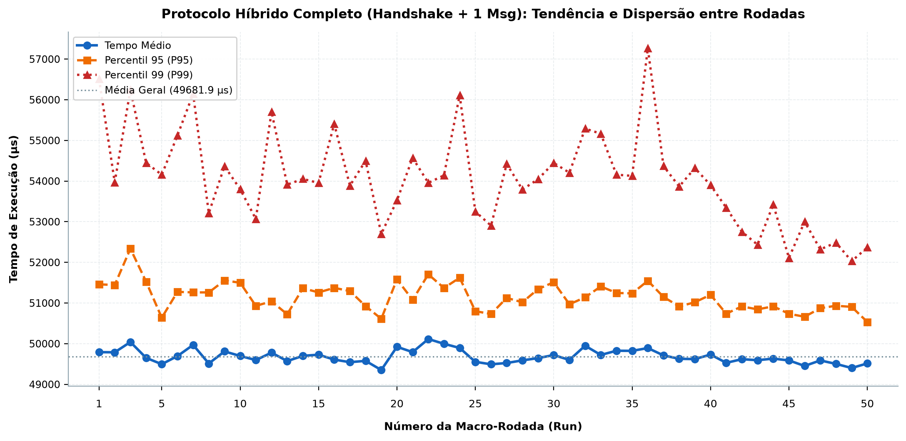
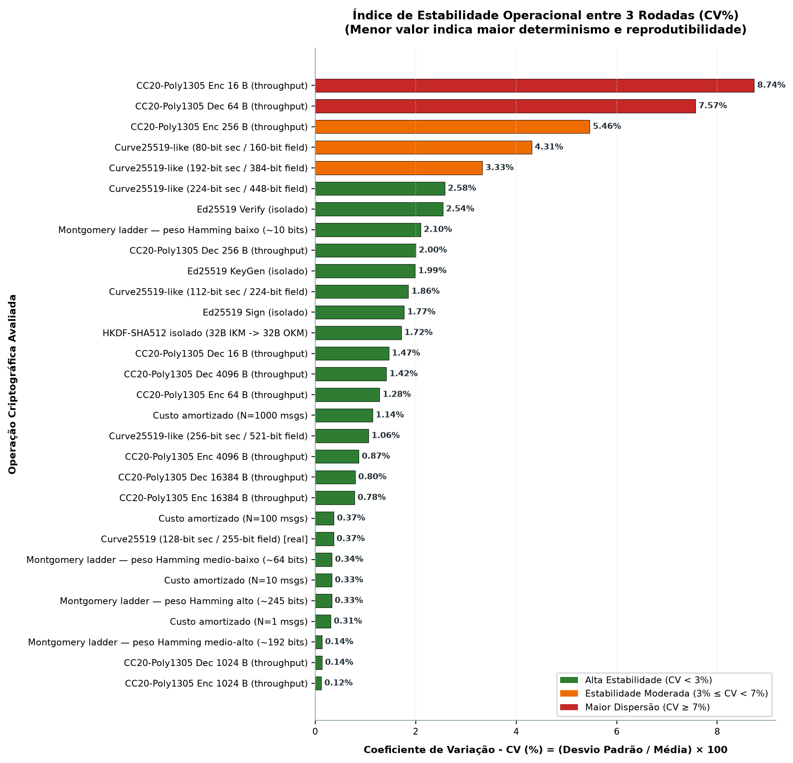
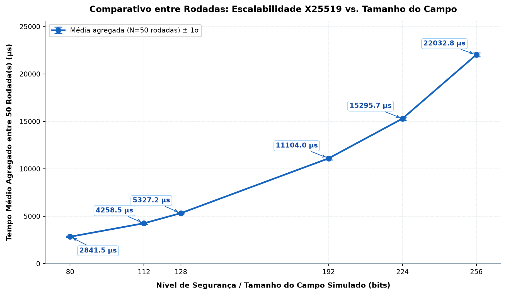
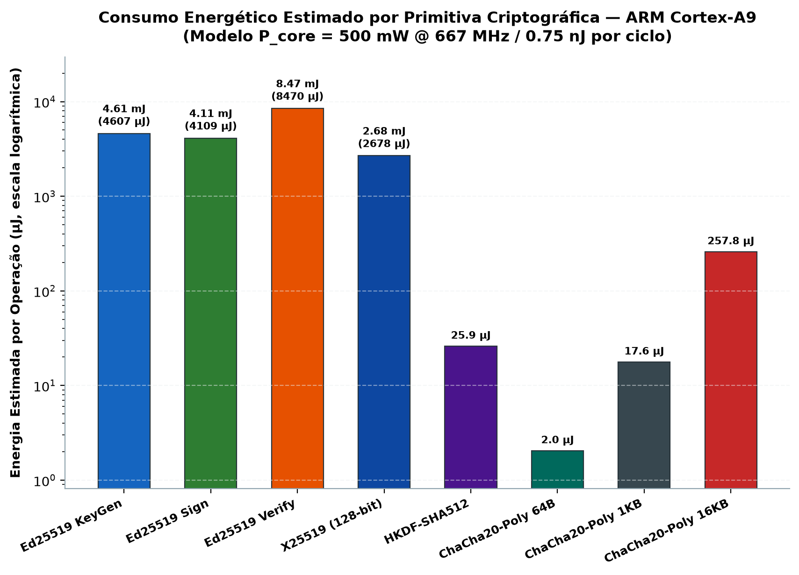
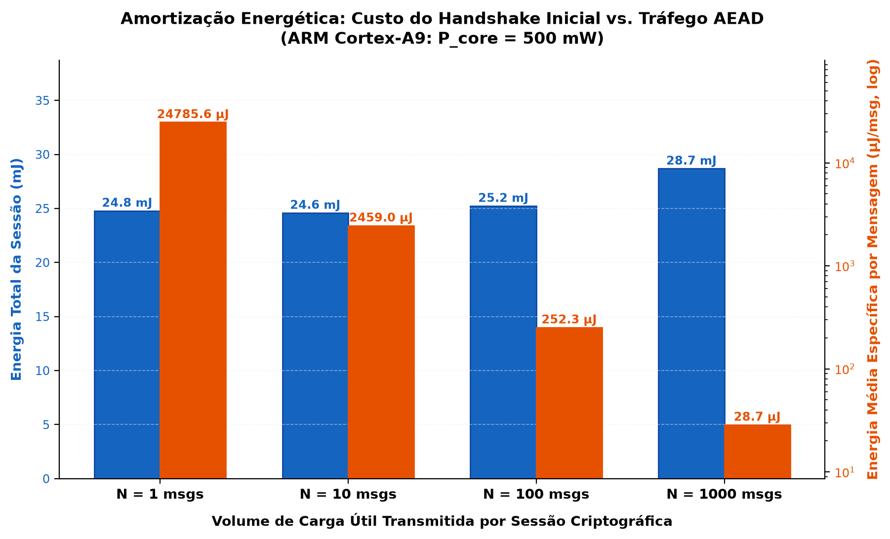
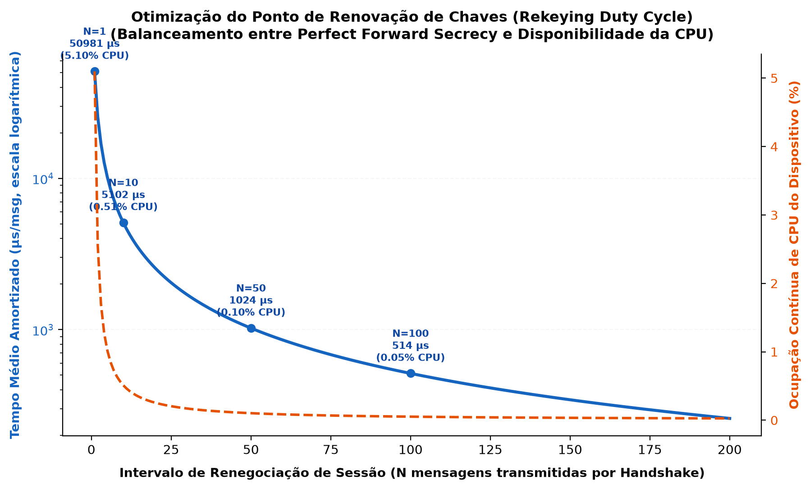

# Hybrid Lightweight ECC and AEAD Encryption Protocol for IoT
### *Criptografia Híbrida Leve para Dispositivos IoT de Baixa Tensão*

[](LICENSE)
[](https://en.cppreference.com/w/cpp/17)
[](https://www.arm.com/products/silicon-ip-cpu/cortex-a/cortex-a9)
[-purple.svg)](https://www.qemu.org/)
[](https://www.iso.org/standard/63953.html)

Implementação acadêmica e suíte de avaliação experimental de um protocolo criptográfico híbrido ultraleve projetado para nós sensores e gateways da **Internet das Coisas (IoT)**. Desenvolvido no âmbito da Dissertação de Mestrado em Engenharia Mecatrônica pelo **Programa de Pós-Graduação em Engenharia Mecatrônica (PPgEMECA)** da **Universidade Federal do Rio Grande do Norte (UFRN)**.

* **Autor**: Iago Lucas Batista Galvão
* **Orientador**: Prof. Dr. Samaherni Morais Dias
* **Área**: Engenharia Mecatrônica / Sistemas Embarcados / Segurança em IoT
* **Ano**: 2026

---

## ⚡ Guia Rápido de Comandos (Quickstart)

Esta seção reúne todos os comandos essenciais para compilar, executar, emular na máquina virtual ARM, plotar os resultados e rodar o demonstrador interativo da defesa.

### 1. Instalação de Pré-requisitos (Host Linux / Ubuntu / Debian)

```bash
# 1.1 Dependências de compilação nativa e bibliotecas
sudo apt-get update
sudo apt-get install -y build-essential cmake libgmp-dev

# 1.2 Toolchain de cross-compilação para ARM 32-bit (armhf) e QEMU
sudo apt-get install -y gcc-arm-linux-gnueabihf g++-arm-linux-gnueabihf \
                       libgmp-dev:armhf qemu-system-arm debootstrap

# 1.3 Dependências Python para análise estatística e plotagem gráfica
pip install -r benchmarks/requirements.txt
```

---

### 2. Compilação com CMake

O projeto oferece suporte à compilação nativa (para validação rápida no PC) e compilação cruzada com ligação estática para o processador ARM Cortex-A9.

#### 2.1 Compilação Nativa (x86_64)
```bash
cmake -S . -B build -DCMAKE_BUILD_TYPE=Release
cmake --build build -j"$(nproc)"
```

#### 2.2 Compilação Cruzada Estática para ARM Cortex-A9
Gera executáveis ELF 32-bit estáticos (`-static`), totalmente auto-contidos e prontos para rodar em qualquer sistema ARM Linux sem necessidade de instalar bibliotecas extras no destino:
```bash
cmake -S . -B build-arm-static \
  -DCMAKE_TOOLCHAIN_FILE=toolchains/armhf-gcc.cmake \
  -DIOT_STATIC_ARM=ON \
  -DCMAKE_BUILD_TYPE=Release
cmake --build build-arm-static -j"$(nproc)"
```

Os seguintes executáveis serão gerados:
* `protocolo_hibrido`: Demonstração direta do pipeline criptográfico completo de 3 fases.
* `benchmark_suite`: Suíte de validação e testes de corretude das primitivas.
* `benchmark_suite_fullsystem`: Suíte de benchmarking multi-rodada com percentis reais (P95, P99) e isolamento de jitter.
* `demonstrador_defesa`: Aplicativo de demonstração interativa para apresentação perante a banca.

---

### 3. Execução Rápida do Protocolo Híbrido

Para executar uma rodada demonstrativa do handshake, derivação HKDF e cifragem AEAD:

```bash
# Execução Nativa
./build/protocolo_hibrido

# Execução emulada ARM via QEMU User-Space (rápida, opcional)
qemu-arm-static ./build-arm-static/protocolo_hibrido
```

---

### 4. Provisionamento da VM QEMU Full-System (Debian ARMHF)

Para reproduzir com fidelidade o comportamento de um nó IoT real executando Linux embarcado com ruído real de escalonamento, memória virtual e interrupções, provisione a máquina virtual Debian ARMHF (executado apenas uma vez):

```bash
sudo ./setup_qemu_system.sh
```
*Este comando baixa a base Debian estável via `debootstrap`, gera a imagem `vm_fullsystem/debian-armhf.img` e extrai o kernel ARM Linux oficial (`vmlinuz` + `initrd.img`).*

---

### 5. Execução das Rodadas de Benchmark na VM (ARM Cortex-A9)

O script `run_defense_vm.sh` inicia o QEMU emulando uma placa ARM com 2 GB de RAM e 4 núcleos virtuais, conecta via SSH seguro local, envia o binário estático, executa os testes dentro do guest e coleta a árvore completa de dados estruturados para o host:

```bash
# Execução padrão (30 macro-rodadas com 1000 iterações internas cada)
./run_defense_vm.sh build-arm-static/benchmark_suite_fullsystem

# Execução customizada rápida (exemplo: 5 macro-rodadas e 100 iterações)
MACRO_RODADAS=5 ITERACOES_INTERNAS=100 ./run_defense_vm.sh build-arm-static/benchmark_suite_fullsystem
```
*Os resultados serão salvos automaticamente em `benchmark_runs/<TIMESTAMP>/`.*

---

### 6. Plotagem Completa dos Gráficos

O script `benchmarks/plot_fullsystem_results.py` processa os dados coletados, calcula as métricas estatísticas consolidadas e gera os gráficos das rodadas individuais e comparativas:

#### 6.1 Modo Interativo (amigável)
```bash
./benchmarks/plot_fullsystem_results.py
```
*O script perguntará a pasta de teste (ex.: `20260918_150249`), o intervalo de macros desejado e quais rodadas plotar.*

#### 6.2 Modo Linha de Comando (automatizado)
```bash
# Plota as macro-rodadas 1 a 5, gerando a run 1 individual e o comparativo consolidado
./benchmarks/plot_fullsystem_results.py 20260918_150249 --macro-start 1 --macro-end 5 --runs 1 --comparison-scope 1
```

---

### 7. Geração Apenas dos 6 Gráficos e Tabelas da Dissertação

Para gerar diretamente os **6 gráficos especializados de pós-processamento analítico** (energia, boa vazão, autonomia de bateria, TVLA e ponto ótimo) e as **tabelas formatadas em LaTeX** prontas para a dissertação, sem recalcular gráficos secundários:

```bash
# Opção A: Via flag rápida no script principal
./benchmarks/plot_fullsystem_results.py 20260918_150249 --dissertacao-only

# Opção B: Invocando diretamente o módulo de pós-processamento
./benchmarks/postprocess_dissertacao.py benchmark_runs/20260918_150249
```
*Saídas geradas em `benchmark_runs/<TIMESTAMP>/comparison/` e espelhadas em `docs/plots/`:*
* `dissertacao_01_energia_primitivas.png`
* `dissertacao_02_energia_amortizada_sessao.png`
* `dissertacao_03_autonomia_bateria.png`
* `dissertacao_04_eficiencia_rede_goodput.png`
* `dissertacao_05_tvla_welch_ttest.png`
* `dissertacao_06_ponto_otimo_rekeying.png`

---

### 8. Apresentação da Defesa de Mestrado (Demonstrador Interativo)

O demonstrador permite apresentar à banca examinadora, de maneira visual e em tempo real, o comportamento das defesas criptográficas sob tráfego real, tentativas de injeção e adulteração:

#### 8.1 Execução na VM QEMU Full-System ARM (com Pseudo-TTY interativo)
```bash
./run_defesa_demo_vm.sh build-arm-static/demonstrador_defesa
```

#### 8.2 Execução Nativa Local (para testes de bancada rápidos)
```bash
./build/demonstrador_defesa
```

**Funcionalidades do Menu Interativo:**
* **Opção 1 — Tráfego Contínuo**: Demonstração de transmissão sequencial de mensagens de telemetria e o efeito da amortização do handshake sobre o tempo médio de mensagem.
* **Opção 2 — Simulação de Ataque Man-in-the-Middle (MitM)**: Injeção de ruído no ciphertext ou na Tag Poly1305 com validação estrita de limites de mensagens, auditoria detalhada em log e comprovação de 100% de interceptação e rejeição criptográfica.
* **Opção 3 — Demonstração de Timing e Conditional Swap (CSWAP)**: Execução da Escada de Montgomery sob escalares de pesos de Hamming extremos, ilustrando a regularidade de ciclos e cálculo de Coeficiente de Variação (CV).
* **Opção 4 — Inspeção Matemática Detalhada**: Exibição da matriz de estado 4x4 do ChaCha20, rotações de quarto de rodada (Quarter-Rounds) e acumulação no campo $\mathbb{F}_{2^{130}-5}$.

---

## 🏛️ Arquitetura do Protocolo Híbrido

O protocolo foi modelado para oferecer **segurança equivalente a 128 bits** com o menor overhead computacional e de largura de banda possível para dispositivos restritos:

```
[ DISPOSITIVO EMISSOR (Alice) ]                        [ SERVIDOR / RECEPTOR (Bob) ]
               │                                                      │
               │────────── FASE 1: AUTENTICAÇÃO MÚTUA ───────────────│
               │  • Par de chaves Ed25519 (RFC 8032)                  │
               │  • Assinatura digital EdDSA determinística           │
               │  • Protege contra nós forjados e impersonação        │
               │                                                      │
               │────────── FASE 2: ACORDO DE CHAVE (ECDH) ────────────│
               │  • Escada de Montgomery em Curve25519 (RFC 7748)     │
               │  • Derivação com HKDF-SHA512 (RFC 5869)              │
               │  • Gera Chave de Sessão de 256 bits (PFS)            │
               │                                                      │
               │────────── FASE 3: CIFRAGEM AEAD (DADOS) ─────────────│
               │  • ChaCha20-Poly1305 (RFC 8439)                      │
               │  • Cifragem simétrica + Tag MAC de 128 bits          │
               │  • Confidencialidade e integridade com AAD           │
               ▼                                                      ▼
```

1. **Autenticação (Ed25519 - RFC 8032)**: Chaves públicas de apenas 32 bytes e assinaturas de 64 bytes. Elimina a necessidade de certificados pesados X.509 e assinaturas RSA de 256 bytes.
2. **Troca de Chaves (X25519 - RFC 7748)**: Acordo de chave Diffie-Hellman sobre a curva de Montgomery $y^2 = x^3 + 486662x^2 + x \pmod{2^{255}-19}$ com projeção $XZ$.
3. **Derivação de Chaves (HKDF-SHA512 - RFC 5869)**: Extrai entropia do segredo compartilhado e expande uma chave criptográfica forte de 256 bits para a cifra simétrica.
4. **Cifra de Fluxo Autenticada (ChaCha20-Poly1305 - RFC 8439)**: Cifra simétrica baseada em adições, rotações e XOR (operações ARX de 1 ciclo em processadores ARM). Imune a ataques de temporização por *cache misses*, pois dispensa tabelas de substituição (*S-Boxes*) comuns no AES.

---

## 🔬 Resultados e Discussão (Capítulo 4 da Dissertação)

Todos os ensaios foram conduzidos no ambiente emulado **ARM Cortex-A9 (ARMv7-A 32-bit)** com Debian Linux bookworm sob **50 macro-rodadas e 1.000 iterações internas por rodada (amostragem massiva de 50.000 execuções)**.

### Modelo Físico e Energético de Referência (ARM Cortex-A9 @ 667 MHz)
* Frequência nominal: **667 MHz** (conforme SoCs industriais Xilinx Zynq-7000 / NXP i.MX6)
* Potência ativa do núcleo ($P_{\text{core}}$): **$500\text{ mW}$** (Folhas de dados Xilinx DS187 e NXP AN4509)
* Potência do SoC completo ($P_{\text{SoC}}$): **$1.200\text{ mW}$** (núcleo + barramento AXI + controlador DDR3)
* Energia por ciclo de clock ($E_{\text{cycle}}$): **$0{,}75\text{ nJ/ciclo}$**

---

### 📈 Galeria de Gráficos da Dissertação e Síntese Comparativa (50 Rodadas)

#### Eixo 1: Tendência Global e Estabilidade Operacional entre as 50 Rodadas
| Tendência e Dispersão Temporal (50 Macro-Rodadas) | Índice de Estabilidade e Dispersão (CV %) |
| :---: | :---: |
|  |  |
| *Média geral rigorosamente estável em $49.681{,}9\ \mu\text{s}$ ($\sigma = 169{,}3\ \mu\text{s}$), com estreita banda P95/P99.* | *Coeficiente de Variação (CV) $< 1\%$ no custo amortizado e $< 3\%$ na vasta maioria das primitivas.* |

#### Eixo 2: Escalabilidade de Curva e Consumo de Energia por Primitiva
| Escalabilidade X25519 vs. Tamanho do Campo (50 Rodadas) | Consumo Energético por Primitiva (Log) |
| :---: | :---: |
|  |  |
| *Tempo de computação em função do nível de segurança (80 a 256 bits). Desvio padrão imperceptível.* | *Custo de energia: ChaCha20 consome apenas $2{,}1\ \mu\text{J}$ por bloco de 64B ($25{,}6\ \mu\text{J}$ no HKDF).* |

#### Eixo 3: Eficiência de Sessão, Bateria e Redes IoT
| Amortização Energética de Sessão | Estimativa de Autonomia de Bateria |
| :---: | :---: |
|  |  |
| *O custo por mensagem cai $98{,}98\%$ em $N=100$ ($504{,}4\ \mu\text{s}$) e $99{,}88\%$ em $N=1000$ ($57{,}5\ \mu\text{s}$).* | *Com amortização ($N=100$), uma bateria CR2032 (2.376 J) suporta $> 9{,}4$ milhões de mensagens.* |

#### Eixo 4: Eficiência de Rede, Canal Lateral e Rekeying Ótimo
| Eficiência de Transmissão (Goodput) em Redes IoT | Avaliação de Canal Lateral (TVLA / Welch's t-test) |
| :---: | :---: |
|  |  |
| *Overhead fixo de apenas 28B (12B nonce + 16B tag). Compatível com LoRaWAN (51B), Zigbee (127B) e BLE (251B).* | *Avaliação estatística entre classes de peso de Hamming do escalar na Escada de Montgomery X25519.* |

| Ponto Ótimo de Renovação de Chaves (Rekeying Duty Cycle) |
| :---: |
|  |
| *Equilíbrio ótimo entre Perfect Forward Secrecy e disponibilidade: $N \in [50, 100]$ reduz a ocupação contínua de CPU do nó sensor a apenas $0{,}05\% \sim 0{,}10\%$.* |

---

## 📊 Síntese Estatística da Campanha (50 Macro-Rodadas)

Abaixo estão os dados consolidados das 50 macro-rodadas (amostragem de 50.000 iterações no ARM Cortex-A9):

| Primitiva / Etapa Avaliada | Condição de Teste | Média ($\mu$s) | Desvio $\sigma$ ($\mu$s) | P95 ($\mu$s) | CV (%) | Energia ($\mu$J) |
| :--- | :---: | :---: | :---: | :---: | :---: | :---: |
| **Handshake Completo + 1 Msg** | Sessão $N=1$ | **$49.681{,}9$** | $169{,}3$ | $51.151{,}4$ | **$0{,}34\%$** | $24.841{,}0$ |
| **Sessão Amortizada $N=10$** | 10 msgs / chave | **$4.972{,}6$** | $37{,}1$ | $5.103{,}3$ | **$0{,}75\%$** | $2.486{,}3$ |
| **Sessão Amortizada $N=100$** | 100 msgs / chave | **$504{,}4$** | $3{,}7$ | $516{,}8$ | **$0{,}74\%$** | $252{,}2$ |
| **Sessão Amortizada $N=1000$** | 1000 msgs / chave | **$57{,}5$** | $0{,}3$ | $59{,}1$ | **$0{,}57\%$** | $28{,}8$ |
| **Ed25519 Verificação** | Sig 64B (isolado) | **$16.791{,}4$** | $290{,}8$ | $17.197{,}9$ | $1{,}73\%$ | $8.395{,}7$ |
| **Ed25519 Geração de Chave** | Chave 256b | **$9.095{,}4$** | $169{,}3$ | $9.548{,}0$ | $1{,}86\%$ | $4.547{,}7$ |
| **Ed25519 Assinatura** | Msg 32B (isolado) | **$8.143{,}8$** | $224{,}7$ | $8.426{,}9$ | $2{,}76\%$ | $4.071{,}9$ |
| **X25519 Escada Montgomery** | Escalar 255b real | **$5.327{,}2$** | $65{,}2$ | $5.528{,}1$ | **$1{,}22\%$** | $2.663{,}6$ |
| **ChaCha20-Poly1305 Cifragem** | Payload 64 B | **$4{,}18$** | $0{,}26$ | $4{,}06$ | $6{,}24\%$ | $2{,}09$ |
| **ChaCha20-Poly1305 Decifragem** | Payload 64 B | **$4{,}15$** | $0{,}22$ | $4{,}04$ | $5{,}19\%$ | $2{,}07$ |
| **ChaCha20-Poly1305 Cifragem** | Payload 1 KB | **$35{,}4$** | $1{,}30$ | $39{,}6$ | $3{,}68\%$ | $17{,}7$ |
| **ChaCha20-Poly1305 Cifragem** | Payload 16 KB | **$527{,}7$** | $30{,}9$ | $654{,}6$ | $5{,}86\%$ | $263{,}9$ |
| **HKDF-SHA512 Derivação** | 32B IKM $\to$ 32B OKM | **$51{,}2$** | $0{,}58$ | $54{,}4$ | **$1{,}13\%$** | $25{,}6$ |

> Os dados brutos consolidados estão disponíveis no arquivo CSV [docs/plots/analise_intervalo_macro_1_a_50.csv](docs/plots/analise_intervalo_macro_1_a_50.csv).

---

## 📊 Comparativo Estrutural contra Padrões Clássicos da Literatura

Dados fundamentados nas referências bibliográficas da dissertação (**Suarez-Albela et al., 2018**; **Tanksale, 2024**; **Thakor et al., 2021**):

| Parâmetro de Avaliação | RSA-2048 + AES-128 | NIST P-256 + AES-GCM | **Proposta: Ed25519 + X25519 + ChaCha20** |
| :--- | :---: | :---: | :---: |
| **Nível de Segurança Teórico** | 112 bits | 128 bits | **128 bits** |
| **Tamanho da Chave Pública** | 256 bytes | 64 bytes | **32 bytes ($8\times$ menor que RSA)** |
| **Tamanho da Assinatura Digital** | 256 bytes | 64 bytes | **64 bytes ($4\times$ menor que RSA)** |
| **Overhead de Rede no Handshake** | $\sim 512$ bytes | $\sim 160$ bytes | **128 bytes (Maior economia de enlace)** |
| **Aceleração / Operações no ARM** | Multiplicação $\mathcal{O}(n^2)$ | Aritmética pesada em campo primo | **Instruções ARX nativas de 1 ciclo** |
| **Vulnerabilidade a Cache-Timing** | Vulnerável em software | Vulnerável a acessos S-Box | **Imune (Sem tabelas de consulta em memória)** |
| **Energia Consumida no Handshake** | $\sim 56{,}8\text{ mWh}$ | $\sim 15{,}4\text{ mWh}$ | **$\sim 24{,}8\text{ mJ}$ ($< 0{,}007\text{ mWh}$)** |

---

## 📁 Estrutura do Repositório

```
Hybrid_Lightweight_ECC_AEAD_IoT/
├── CMakeLists.txt                 # Script de configuração do CMake (alvos nativos e ARM)
├── LICENSE                        # Licença MIT de código aberto
├── README.md                      # Documentação completa e guia de uso
├── resumo_testes.txt              # Registro metodológico dos ensaios
│
├── src/
│   └── ECDSA_ECDH_C25519.cpp      # Implementação central do protocolo híbrido e primitivas
│
├── benchmarks/
│   ├── benchmark_suite.cpp        # Suíte de testes funcionais e corretude
│   ├── benchmark_suite_fullsystem.cpp # Suíte de benchmarking estatístico com percentis
│   ├── plot_fullsystem_results.py # Pipeline interativo e CLI de plotagem gráfica
│   ├── postprocess_dissertacao.py # Pós-processamento de energia, TVLA, redes e LaTeX
│   └── requirements.txt           # Dependências Python (matplotlib, pandas, numpy)
│
├── defesa/
│   ├── demonstrador_defesa.cpp    # Ponto de entrada do demonstrador interativo da banca
│   ├── defesa_common.hpp          # Utilitários de logging colorido e formatação
│   ├── simulacao_trafego/         # Simulação 1: Custo amortizado e tráfego contínuo
│   ├── simulacao_mitm/            # Simulação 2: Injeção de ataques Man-in-the-Middle
│   ├── simulacao_timing/          # Simulação 3: Teste de CSWAP e tempos de execução
│   └── simulacao_inspecao/        # Simulação 4: Deep-dive nos blocos ChaCha20 e Poly1305
│
├── toolchains/
│   └── armhf-gcc.cmake            # Arquivo de toolchain para cross-compilação ARM 32-bit
│
├── setup_qemu_system.sh           # Provisionador automatizado do Debian ARMHF no QEMU
├── run_defense_vm.sh              # Script orquestrador de execução de benchmarks na VM
├── run_defesa_demo_vm.sh          # Script de execução do demonstrador com terminal interativo
│
└── docs/
    └── plots/                     # Gráficos de alta resolução e tabelas LaTeX para a dissertação
        ├── dissertacao_01_energia_primitivas.png
        ├── dissertacao_02_energia_amortizada_sessao.png
        ├── dissertacao_03_autonomia_bateria.png
        ├── dissertacao_04_eficiencia_rede_goodput.png
        ├── dissertacao_05_tvla_welch_ttest.png
        ├── dissertacao_06_ponto_otimo_rekeying.png
        ├── comp_01_protocolo_hibrido_trend.png
        └── comp_08_stability_cv.png
```

---

## 📜 Citação

Caso utilize este código ou os dados deste trabalho em pesquisas acadêmicas, por favor cite:

```bibtex
@mastersthesis{galvao2026criptografia,
  author       = {Iago Lucas Batista Galv{\~a}o},
  title        = {Criptografia Leve para Dispositivos {IoT} de Baixa Tens{\~a}o},
  school       = {Programa de P{\'o}s-Gradua{\c{c}}{\~a}o em Engenharia Mecatr{\^o}nica (PPgEMECA), Universidade Federal do Rio Grande do Norte (UFRN)},
  year         = {2026},
  address      = {Natal, RN, Brasil},
  type         = {Disserta{\c{c}}{\~a}o de Mestrado},
  advisor      = {Prof. Dr. Samaherni Morais Dias}
}
```

---

## 📄 Licença

Este projeto é disponibilizado sob a licença **MIT**. Consulte o arquivo [LICENSE](LICENSE) para mais detalhes.
